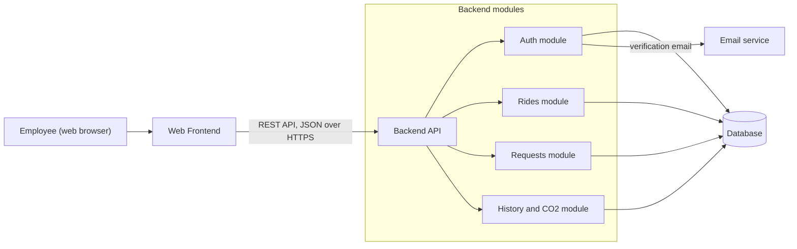

# Architecture: EcoRide Office Carpool MVP

## High-Level System Diagram

## Components

| Component | Responsibility |
|---|---|
| Web Frontend | Pages for sign-up, login, posting a ride, searching rides, managing requests and viewing history. Works in a desktop and mobile browser. |
| Backend API | Single REST API that validates input and applies the business rules (seat limits, one request per offer, company email check). |
| Auth module | Sign-up and login, company email domain check, session or token handling. |
| Rides module | Create, cancel and search ride offers by area and time. |
| Requests module | Create seat requests; the driver accepts or declines; updates free seats. |
| History and CO2 module | Lists completed rides and calculates the estimated CO2 saved. |
| Database | Stores users, ride offers and seat requests (see `data_model.md`). |
| Email service | Sends the email used to confirm that a user owns a company address. |

## Main Flow
1. A driver logs in and posts a ride offer (frontend, Backend API, Rides module, database).
2. A rider searches offers by area and time and sends a seat request (Requests module).
3. The driver accepts or declines the request; the rider sees the new status.
4. After the ride, both users see it in their history with an estimated CO2 saving.

## Design Decisions
- **One backend and one database** keep the MVP simple for a single developer.
- **Matching by area name and time** instead of maps and GPS, because routing and live tracking are outside the MVP scope.
- **Company email verification** is the only identity check, which fits the pilot for a single company.
- **Free-tier hosting** for the frontend, backend and database to respect the budget constraint.
- The exact technology stack (frameworks, hosting provider) is chosen in the implementation phase.
