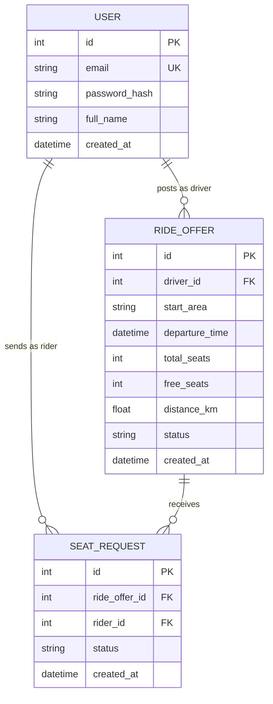

# Data Model: EcoRide Office Carpool MVP

The MVP uses three entities. Trip history is not a separate entity: it is built from ride offers with the status "completed" and seat requests with the status "accepted".

## Entity Relationship Diagram

## Entities

### User
An employee who can be a driver, a rider or both.

| Field | Type | Notes |
|---|---|---|
| id | integer | Primary key |
| email | string | Unique; must belong to the allowed company domain |
| password_hash | string | Hashed password, never the plain text |
| full_name | string | Shown to other users |
| created_at | datetime | Account creation time |

### RideOffer
A ride posted by a driver (user stories 3, 4 and 6).

| Field | Type | Notes |
|---|---|---|
| id | integer | Primary key |
| driver_id | integer | Foreign key to User |
| start_area | string | Area name where the ride starts |
| departure_time | datetime | When the ride leaves |
| total_seats | integer | Free seats offered at creation, at least 1 |
| free_seats | integer | Seats still available; decreases when a request is accepted |
| distance_km | float | Optional; entered by the driver and used for the CO2 estimate |
| status | string | `active`, `cancelled` or `completed` |
| created_at | datetime | When the offer was posted |

### SeatRequest
A rider's request to join a ride (user stories 5, 7 and 8).

| Field | Type | Notes |
|---|---|---|
| id | integer | Primary key |
| ride_offer_id | integer | Foreign key to RideOffer |
| rider_id | integer | Foreign key to User |
| status | string | `pending`, `accepted` or `declined` |
| created_at | datetime | When the request was sent |

## Relationships
- One User posts many RideOffers (as driver).
- One User sends many SeatRequests (as rider).
- One RideOffer receives many SeatRequests.

## Rules
- A rider can send only one SeatRequest per RideOffer (unique pair `ride_offer_id` + `rider_id`).
- A request can be accepted only while `free_seats` is greater than 0.
- A driver cannot request a seat on their own offer.
- The estimated CO2 saved is calculated from `distance_km` and a configurable emission value; it is not stored and is shown as an estimate.
